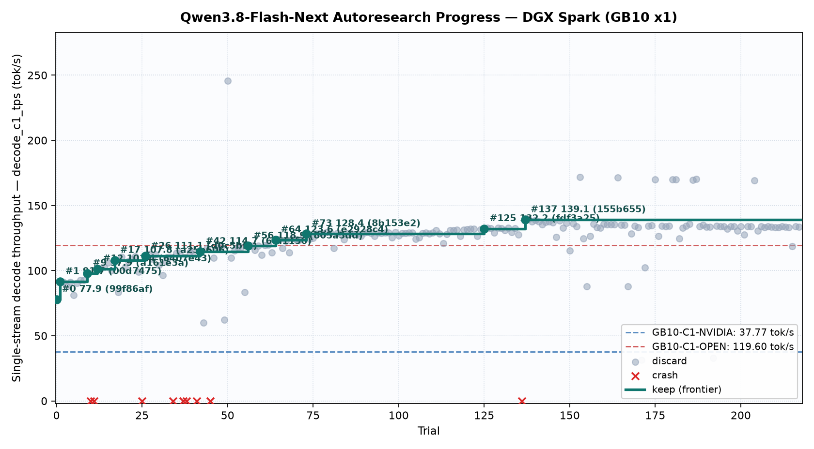
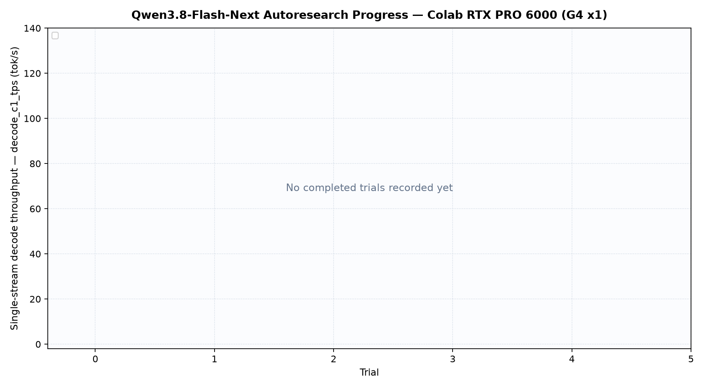

# Qwen3.8-Flash-Next Inference Speed Autoresearch

Autonomous [karpathy/autoresearch](https://github.com/karpathy/autoresearch)-style optimization loop targeting world-record single-stream and concurrent inference throughput for **`Qwen/Qwen3.8-Flash-Next`** (125B backbone + 51B n-gram embedding table, 6B active parameters per token, 262,144 native context) while enforcing a strict **GPQA Diamond accuracy guard**.

## 1. Purpose & Goals

1. **Surpass published hardware records under strict accuracy preservation**: Beat both the NVIDIA published recipe reference (**37.77 tok/s** active decode on GB10) and the highest open single-device GB10 report (**119.6 tok/s**, achieved under accuracy-relaxing settings) while keeping GPQA Diamond within **1.0 percentage point (2 items on `G198`)** of the baseline.
2. **Two independent hardware tracks** (never mixed across architectures):
   - **Track A (`spark/`)**: Single **NVIDIA DGX Spark (GB10, SM121, 128 GB unified memory, aarch64)**.
   - **Track B (`colab/`)**: Single **NVIDIA RTX PRO 6000 Blackwell (G4, 96 GB VRAM, x86_64)** on Google Colab.
3. **Verifiable claims only**: Unmeasured numbers are left blank, published numbers carry primary-source URLs and exact measurement conditions in [`records/world-records.tsv`](records/world-records.tsv), and no "world record" claim is made without matching conditions and re-measuring the reference engine on identical hardware.

---

## 2. Stepwise Improvement Progress

### Track A — NVIDIA DGX Spark (GB10 x1)



Full ledger: [`spark/results.tsv`](spark/results.tsv)

### Track B — Colab NVIDIA RTX PRO 6000 (G4 x1)



Full ledger: [`colab/results.tsv`](colab/results.tsv)

---

## 3. Current Best Verified Configurations

<!-- FRONTIER_TABLE_START -->
| Track | Hardware | Best Trial | Commit | `decode_c1_tps` | `total_c4_tps` | `total_c8_tps` | `total_c16_tps` | `ttft_c1_s` | `prefill_tps` | GPQA Guard | Engine & Quantization |
|---|---|---|---|---:|---:|---:|---:|---:|---:|---|---|
| `spark` | DGX Spark (GB10 x1) | `137` | `155b6558` | **139.10** | 187.10 | 252.52 | 296.73 | 0.144 s | 1,447.57 | `hash_match=1`; `G198` 185/198 (93.4%, out-of-loop run, [§3.1](#31-gpqa-diamond-full-set-measurement-trial-137)) | TensorFold v1.2.9 (`6b9de695`, `spark/candidate.sh` patches) + NVFP4 (`fc694b54`) |
| `colab` | RTX PRO 6000 (G4 x1) | — | — | — | — | — | — | — | — | — | — |
<!-- FRONTIER_TABLE_END -->

*(Baseline trial `0` on the current Spark stack: `77.93` tok/s `decode_c1_tps`, commit `99f86afa`. Trial `137` passed the accuracy guard via greedy 16-prompt exact output match `hash_match=1` with GPQA columns blank in `spark/results.tsv`; the full `engine` tag is recorded in `spark/results.tsv`. The `G198` figure comes from a separate full-set run outside the trial loop, reported with its conditions in §3.1; it is not recorded in the ledger. Other cells remain `—` until measured by the frozen harness and recorded in `<site>/results.tsv`.)*

### 3.1 GPQA Diamond Full-Set Measurement (Trial 137)

All 198 GPQA Diamond items were scored once on the trial `137` build on 2026-11-26 (JST), outside the trial loop. The speed benchmark above runs with thinking off; this run uses the thinking-on profile of the same build.

| Item | Value |
|---|---|
| Result | **185 / 198 correct (93.4%)**, single run. Wilson 95% interval: 89.1–96.1% |
| Misses | 13: 12 answered with a wrong choice, 1 reached the output cap without an answer line. 0 request errors |
| Subsets | `G13` 12 / 13, `G40` 36 / 40 |
| Build | Trial `137` (`155b6558`): TensorFold v1.2.9 (`6b9de695`) + `spark/candidate.sh` patches, NVFP4 (`fc694b54`), MTP speculative decoding on |
| Serving profile | Thinking on, context 139,264 × 2 slots, BF16 KV cache, prompt cache off |
| Request and grading | `eval_one` in the frozen [`bench/guard.py`](bench/guard.py), unchanged: `temperature=1.0`, `top_p=0.95`, `top_k=20`, `seed=42`, `reasoning_effort="xhigh"`, thinking enabled, 2 clients; the last `Answer: X` line is graded |
| Output cap | `max_tokens=131072`, the condition on the NVIDIA model card, instead of the guard default `32768` (see the notes below) |
| Output tokens | 3,366,723 in total; per item: mean 17,004, median 7,521, p90 50,630 |
| Wall time | 12 h 23 min on one DGX Spark, including one restart to raise the cap |

Published values for comparison:

| Checkpoint | GPQA Diamond | Published conditions | Source |
|---|---:|---|---|
| `Qwen/Qwen3.8-Flash-Next` (before quantization) | 91.7% | Not stated on the model card | <https://huggingface.co/Qwen/Qwen3.8-Flash-Next> |
| `nvidia/Qwen3.8-Flash-Next-NVFP4` (the weights used here) | 91.5% (FP8 on the same card: 92.0%) | `temperature=1.0`, `top_p=0.95`, `max_new_tokens=131072`, `reasoning_effort=xhigh`; vLLM on B200 / B300 | <https://huggingface.co/nvidia/Qwen3.8-Flash-Next-NVFP4> |

- **Reading the number.** One item is 0.5 points and the interval above contains both published values, so the 1.7 to 1.9 point gap is within single-run noise. The result shows no measurable accuracy loss against the published values; it does not show an improvement over them.
- **Not a guard verdict.** `program.md` defines the `G198` guard relative to baseline `A0` (trial `0`), which has not been scored. The GPQA columns in `spark/results.tsv` therefore stay blank, and this number is compared only with published values.
- **Output cap.** The first 27 items ran at the guard default of 32,768 tokens. Three of them reached the cap mid-reasoning with no answer, so the cap was raised to 131,072 for the rest of the run and those three were retaken (38,730 / 46,850 / 62,574 tokens: wrong, wrong, correct). The 24 that had finished on their own were kept.
- **Cap sensitivity.** 33 of the 198 items produced more than 32,768 output tokens, and 25 of those were correct. Scored at a 32,768 cap, the same run would be 160 / 198 (80.8%).
- **Differences from the model-card setups.** `top_k=20` and a fixed seed are set; the engine is TensorFold with speculative decoding rather than vLLM; the prompt format and answer extraction are this repository's; one run only.
- **Records.** Per-item records (Record ID SHA-256, correct or not, finish reason, token count, timing) are kept in the untracked `../private/` directory. No question text or model output was stored. The run used a resumable wrapper around `eval_one` that is kept outside the repository; the frozen CLI equivalent is:

```bash
python3 bench/guard.py --mode eval --split G198 --clients 2 --max-tokens 131072 \
  --bundle ../private/eval-bundle.json --out ../private/gpqa-g198.json
```

---

## 4. Hardware Environments

| Track | Accelerator | Architecture | Memory | OS / Driver Notes |
|---|---|---|---|---|
| `spark` | NVIDIA GB10 (DGX Spark × 1, SM121) | `aarch64` | 128 GB coherent unified memory | Linux (Ubuntu 24.04 arm64), CUDA 13.x / R580 open driver |
| `colab` | NVIDIA RTX PRO 6000 Blackwell (Colab G4 × 1) | `x86_64` | 96 GB GDDR7 VRAM | Google Colab managed container runtime |

---

## 5. Method (`karpathy/autoresearch` Mapping)

| `karpathy/autoresearch` | This Repository | Rule |
|---|---|---|
| `program.md` | [`program.md`](program.md) | Human-authored policy & constraints only; read-only for trial agents |
| `prepare.py` (frozen) | [`bench/`](bench/) + [`bench/FROZEN.sha256`](bench/FROZEN.sha256) | Frozen measurement, GPQA guard, recording, plotting, and secret scan; SHA-256 verified before every trial |
| `train.py` (single editable file) | [`spark/candidate.sh`](spark/candidate.sh) / [`colab/candidate.sh`](colab/candidate.sh) | **Only file a trial agent may edit**. Holds engine version, weights revision, CLI flags, environment variables, and inline kernel/scheduler/speculative patches |
| `val_bpb` | `decode_c1_tps` (tok/s) | Primary metric: median single-stream decode `(completion_tokens - 1) / (t_last - t_first)` across 3 repeats of 400 fixed output tokens (`temperature=0`, `ignore_eos=True`, thinking off, cache off) |
| Secondary constraints | `total_c4_tps`, `total_c8_tps`, `ttft_c1_s` | Must retain `>= 97%` of parent `c4`/`c8` throughput and `<= 110%` of parent `ttft_c1_s` |
| Accuracy guard | [`bench/guard.py`](bench/guard.py) | Greedy 16-prompt SHA-256 exact match (`hash_match=1`) OR GPQA Diamond `G40` within 2 items of parent (`G198` within 2 items / 1.0 pt of baseline `A0` whenever setting a new best) |
| `keep` / `discard` / `crash` | Same + cold-start reproduction | `keep` requires `>= max(3%, 2σ)` gain over parent, guard pass, and reproduction on a 2nd independent server cold start. `discard`/`crash` commits are preserved as `trial/<site>/<N>` tags before `git reset --hard` |

### Privacy & Benchmark Integrity
- **GPQA Diamond protection**: Question bodies, multiple-choice options, explanations, and model completions are **never** stored in this repository. [`bench/prepare_inputs.py`](bench/prepare_inputs.py) fetches public upstream datasets into an untracked `../private/` directory and verifies Record ID SHA-256 digests against [`bench/guard-ids.sha256`](bench/guard-ids.sha256).
- **Automated pre-push audit**: [`bench/scan_secrets.sh`](bench/scan_secrets.sh) scans working files, commit history, PNG ancillary chunks, and all 198 GPQA prompts/choices before every push.

---

## 6. Comparison with Published Records

Source table with full metadata: [`records/world-records.tsv`](records/world-records.tsv). Only `verified` entries with primary sources and documented conditions serve as comparison targets; `candidate` entries are listed for reference until primary conditions are confirmed.

| `record_id` | Hardware | Status | Published Value | Metric & Conditions | Accuracy Note | Primary Source | Our Same-Harness Re-measure |
|---|---|---|---:|---|---|---|---:|
| `GB10-C1-OPEN` | DGX Spark (GB10) × 1 | `verified` | **119.6 tok/s** | Single-stream decode; Hibana fast profile (3-bit weights, expert sharing, adaptive MTP depth 4, 2-bit draft head, relaxed verification `s=0.5`, NVFP4 KV); SPEED-Bench, reasoning on | Paper Table 4: GPQA 90.7% → 89.1% (−1.6 pt); Table 6 (248K budget): 87.0% (−3.7 pt) — outside our 1.0 pt guard | [arXiv:2611.10469v1](https://arxiv.org/abs/2611.10469v1), [Hibana v0.1.0](https://github.com/sharar-project/hibana/releases/tag/v0.1.0) | 189.15 tok/s (`fast`, 400-tok code) / **78.67 tok/s** (`exact`, `G13` 13/13) |
| `GB10-C1-NVIDIA` | DGX Spark (GB10) × 1 | `verified` | **37.77 tok/s** | `aiperf` `active_decode_throughput.avg`; vLLM `0.1.dev21830` (`b12x`) + `FP4-Local@b9ce18a6`, MTP 4, FP8 KV, ctx 262,144, 10 sequential SPEED-Bench coding turns | Model card GPQA Diamond 91.5% (vs BF16 92.2%) | [NVIDIA recipe `performance.yaml`](https://github.com/NVIDIA/local-ai-inference-recipes/blob/bb515086841e7a81e7d51925561338e7dee35023/models/qwen/qwen3.8-flash-next/dgx-spark/linux/vllm/fp4-local/performance.yaml) | **44.73 tok/s** (`FP4-Local` + TensorFold) / **42.15 tok/s** (`NVFP4` + Hibana `exact`) |
| `GB10-C1-MIA` | DGX Spark (GB10) × 1 | `candidate` | 110.5 tok/s | TensorFold v1.1.4 + 17 patches + `FP4-Local`, `sparkDash` code prompt | GPQA not reported | [MiaAI-Lab repo](https://github.com/MiaAI-Lab/Qwen3.8-Flash-Next-Single-DGX-Spark-TensorFold/blob/20e15e41f2f514a0d287710f4665ee1b5009ba41/README.md) | — |
| `GB10-C1-DIFFBOT` | DGX Spark (GB10) × 1 | `candidate` | 65.3 tok/s | vLLM + `b12x` + FP4-Local + fine-tuned MTP 4; private coding replay set | GPQA not reported | [Model card](https://huggingface.co/diffbot/Qwen3.8-Flash-Next-FP4-Local-DGX-Spark/blob/38b78560cc7d4b91287c9d5bb49da728e16f46eb/README.md) | — |
| `GB10-C1-B12X-NOV3` | DGX Spark (GB10) × 1 | `candidate` | 68.1 tok/s | Secondary aggregator listing (vLLM `b12x`, NVFP4, MTP 4); primary source pending | Not measured | [Aggregator page](https://www.contextstudios.ai/local-ai/vcruz305--qwen38-flash-next-nvfp4-1spark-vllm-b12x) | — |
| `GB10-C4-OPEN` | DGX Spark (GB10) × 1 | `candidate` | 238.7 tok/s | 4-request aggregate decode, Hibana v0.1.0 fast profile, fixed MTP depth 6 (conditions incomplete) | Not stated | [Hibana `docs/flashnext.md`](https://github.com/sharar-project/hibana/blob/v0.1.0/docs/flashnext.md) | — |
| `RTX6000-C1-SGLANG` | RTX PRO 6000 × 1 | `candidate` | ~207 tok/s | Secondary aggregator listing (SGLang, NVFP4); primary source & conditions pending | Not stated | [Aggregator post](https://www.contextstudios.ai/blog/one-model-six-hardware-tiers-what-we-measured) | — |
| `RTX6000-C1-MAXQ` | RTX PRO 6000 Max-Q × 1 (OC) | `candidate` | 173 tok/s | Overclocked Max-Q card, NVFP4 + MTP 3; primary URL pending | Not stated | Pending primary URL | — |

---

## 7. Reproduction

```bash
# 1. Fetch public code prompts and GPQA Diamond into untracked ../private/eval-bundle.json
#    and verify SHA-256 digests against bench/guard-ids.sha256
python3 bench/prepare_inputs.py

# 2. Verify frozen benchmark integrity
shasum -a 256 -c bench/FROZEN.sha256

# 3. Configure target host connection outside git (../private/host.env)
#    export QFN_SSH_TARGET="<your-gb10-ssh-host>"
#    export QFN_REMOTE_DIR='$HOME/qfn-autoresearch'
#    export QFN_PORT="29771"

# 4. Run a single trial from a loop worktree (e.g., ../loop-spark)
bash bench/run_trial.sh spark

# 5. Or launch the continuous autonomous loop inside tmux
tmux new-session -d -s qfn-ar-spark -c ../loop-spark \
  'bash bench/loop.sh spark 2>&1 | tee -a ../private/loop-spark.log'
```
